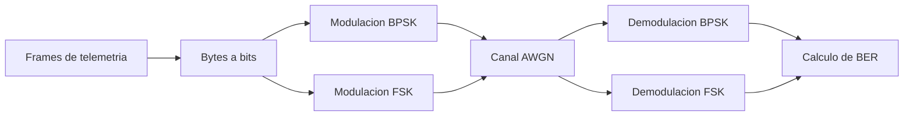
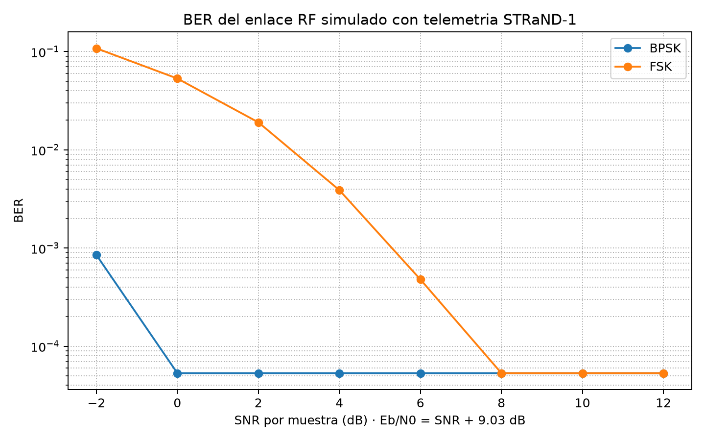
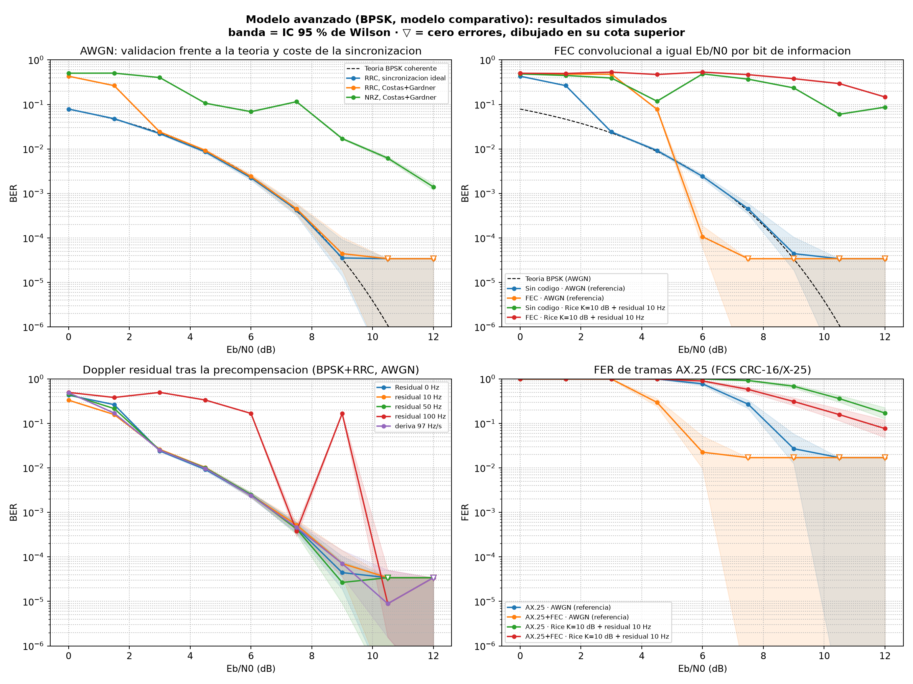
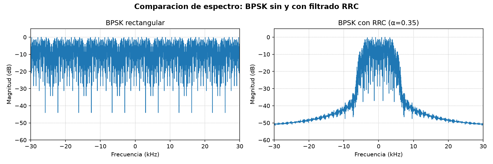
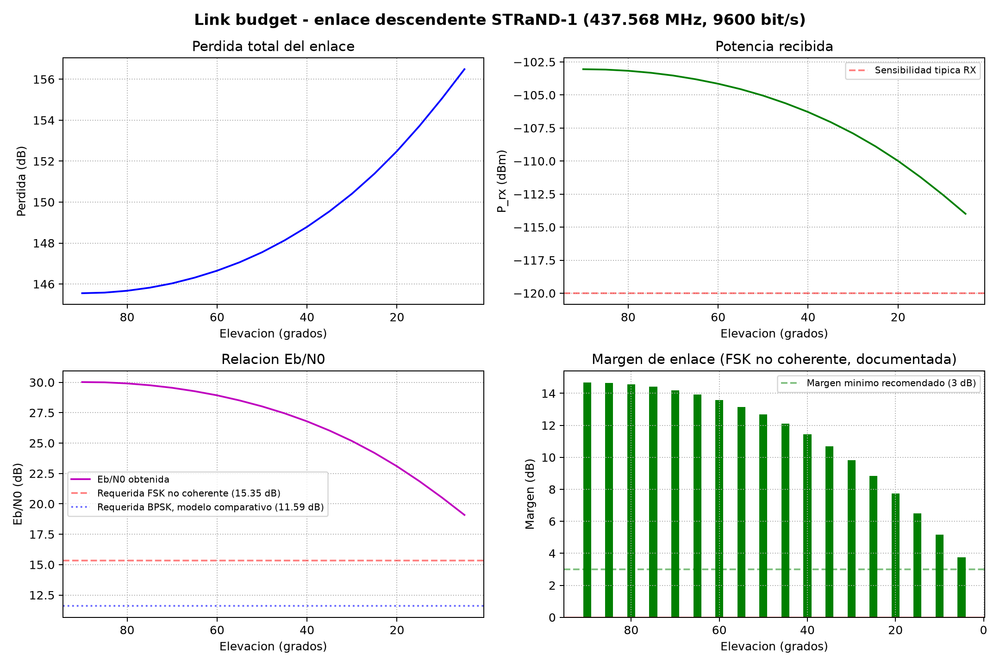

# Caracterizacion y simulacion del enlace RF de un CubeSat

Proyecto aplicado de Ingenieria Electronica orientado a caracterizar el subsistema de comunicaciones de un CubeSat y documentar un modelo reproducible de transmision/recepcion de senales RF moduladas en BPSK y FSK.

> **Modulacion real y modulacion del modelo.** La baliza UHF de STRaND-1 esta documentada como **FSK a 9600 bit/s con tramas AX.25 (HDLC) y codificacion NRZI** (AMSAT-UK; SatNOGS DB). Ninguna fuente consultada describe BPSK en este satelite. La BPSK coherente del modelo avanzado y de la cadena GNU Radio es un **modelo comparativo de banda base**. Los resultados de simulacion no son mediciones del enlace real. La auditoria completa esta en [`docs/AUDITORIA_GEMELO_RF.md`](docs/AUDITORIA_GEMELO_RF.md).

El trabajo se desarrolla como referencia tecnica en espanol para apoyar futuros proyectos academicos de desarrollo satelital en Colombia.

## Objetivo general

Simular el enlace de radiofrecuencia (RF) de un CubeSat de observación mediante herramientas de software libre, utilizando telemetría real y un modelo digital que permita analizar la modulación, el canal, la recepción y la tasa de error de bit (BER, Bit Error Rate).

## Objetivos especificos

1. Caracterizar los componentes de comunicaciones de STRaND-1 —antena, transceptor, módem y sistema de telemetría, seguimiento y comando (TT&C, Telemetry, Tracking and Command)— como referencia para un CubeSat de observación.
2. Implementar un modelo reproducible de enlace digital en banda base para las modulaciones BPSK (Binary Phase Shift Keying) y FSK (Frequency Shift Keying), con BER (Bit Error Rate), espectro y archivos IQ (componentes In-phase y Quadrature) compatibles con GNU Radio.
3. Evaluar el comportamiento del enlace bajo conformado RRC (Root Raised Cosine), desvanecimiento Rice, Doppler residual, codificación convolucional, verificación AX.25 (Amateur X.25), presupuesto de enlace y seguimiento de estación terrenal.
4. Integrar el modelo digital del enlace RF (Radio Frequency) con la telemetría real de STRaND-1 para el análisis conjunto de las condiciones de comunicación y la tasa de error de bit (BER, Bit Error Rate).

## Delimitacion del alcance

El proyecto es una caracterizacion y simulacion academica reproducible; no construye ni opera un satelite, ni repara fisicamente STRaND-1. El enlace RF se modela como un equivalente digital en banda base: no se sintetiza ni se recibe una portadora UHF real. La sincronizacion de portadora y simbolo se recupera con lazos de Costas y Gardner (ver seccion 5.7 del informe), y la de trama se localiza por desplazamiento conocido. La validacion con capturas IQ de un SDR en un paso real queda como trabajo futuro; el repositorio define el formato para conservarlas y una captura de referencia sintetizada. Por tanto, los resultados validan el modelo y sus decisiones de diseño dentro de esas condiciones, no certifican por si solos un receptor de vuelo.

## Trazabilidad y fuente de resultados

- El informe integrador vigente es `docs/INFORME_TECNICO_FINAL.md`; este README resume sus resultados y no debe contradecirlo.
- Los valores numericos se obtienen de los scripts y archivos de `resultados_simulacion/`; `generar_tablas_informe.py` actualiza las tablas marcadas del informe a partir de dichos archivos.
- El pipeline reproducible, en el orden indicado en la seccion **Uso**, es la fuente de verdad de cualquier resultado regenerado. Si cambia un parametro o un script, se deben regenerar los archivos de resultados y el informe antes de actualizar este resumen.
- La plataforma de telemetria conserva por separado los datos `RAW`, `PROCESSED`, `DECODED` y `UNKNOWN`; una magnitud fisica solo se publica cuando su protocolo y su conversion estan validados.

## Alcance del proyecto

Este repositorio contiene el desarrollo completo del proyecto de caracterizacion:

### Modelo de simulacion RF
- Descarga y organizacion de telemetria real del satelite STRaND-1 via SatNOGS: 36641 frames,
  combinando el archivo historico de SatNOGS DB (2016-2022) con las observaciones de SatNOGS
  Network (2022-2026), con la ventana de la transicion de 2020-2021 descargada dia a dia.
- Decodificacion de payloads hexadecimales a bytes/binario (2347 bytes, 18776 bits).
- Modulacion BPSK y FSK en banda base con 8 muestras/simbolo a 9600 bps.
- Canal AWGN con barrido de SNR (-2 a 12 dB).
- Demodulacion coherente (BPSK) y por correlacion (FSK).
- Calculo de BER y exportacion de senales IQ para GNU Radio.

### Modelo avanzado
- BPSK de banda base (modelo comparativo) con filtrado conformador RRC (α=0.35) y filtro adaptado.
- **Sincronizacion real**: lazo de Costas (portadora, 80 Hz) y recuperacion Gardner (simbolo) con un desfase inicial de 0.35 muestras; ambiguedad de fase resuelta con una palabra de sincronismo.
- Desvanecimiento Rice (K = P_LOS/P_difusa = 10 dB, potencia media unitaria): **escenario hipotetico**, sin medidas de canal de STRaND-1.
- Doppler **residual** tras la pre-compensacion por TLE (10, 50 y 100 Hz, y deriva de 97 Hz/s), con valores tomados del paso SGP4.
- Codificacion convolucional (r=1/2, K=7, polinomios 171,133) con Viterbi de decision dura.
- Tramas AX.25 2.2 con FCS CRC-16/X-25: tramas validas, invalidas y no recuperadas.
- Todas las configuraciones se comparan **a igual Eb/N0 por bit de informacion, sobre los mismos bits, el mismo ruido y el mismo desvanecimiento** (semillas registradas), con varios ensayos por punto.
- Metricas: BER, BER diferencial, PER y FER con intervalos de confianza de Wilson; N/A cuando no hay denominador.

### Presupuesto en un paso SGP4, estimacion de SNR y recepcion real
- `parametros_enlace.py`: fuente unica de los parametros del enlace, con la **procedencia** de cada uno (documentado, deducido, supuesto) y los umbrales teoricos por esquema.
- `margen_paso_sgp4.py`: TLE -> SGP4 -> Doppler y su derivada -> residual -> rotor -> margen en el tiempo, con percentiles, intervalos de margen positivo y sensibilidad (uno a la vez y Monte Carlo).
- `estimar_snr_iq.py`: estimador M2M4 de Es/N0 sobre las muestras IQ, contrastado con la SNR conocida (sesgo y dispersion por tamaño de ventana).
- `telemetria_strand1/tools/analizar_recepcion.py`: metadatos disponibles, coincidencias entre estaciones (M0KSF / M0KSF-BB), ganancia por combinacion y perdida de paquetes por numero de secuencia.

### SGP4 y validacion SDR
- `orbita_sgp4.py` + `simular_paso_sgp4.py`: paso orbital con el propagador SGP4 y el TLE de STRaND-1 versionado en `tle/` con su epoca.
- `validar_captura_iq.py` + `generar_captura_iq_referencia.py`: formato inmutable de captura IQ (binario + manifiesto JSON) y una captura de referencia sintetizada desde la telemetria real con el Doppler SGP4 aplicado.

### Pruebas automatizadas
- `pytest` con dependencias declaradas en `requirements.txt` (pytest, sgp4). Cubren el presupuesto de enlace contra casos calculados a mano, la curva BER en AWGN, la normalizacion del canal Rice, la reproducibilidad con semillas, el Doppler SGP4, los contadores AX.25/FCS, los denominadores de BER/PER/FER y la **coherencia entre resultados, informe, pagina estatica y frontend**.

### Flujogramas GNU Radio
- `simulacion_visualizar_iq.grc`: visualizacion IQ con control interactivo de ruido AWGN (time/freq/constellation sinks).
- `simulacion_cadena_completa.grc`: cadena BPSK completa desde bytes de telemetria hasta demodulacion con 5 sinks visuales.

### Gemelo digital
- Reconstruccion del estado del satelite por ultimo valor conocido, con la **edad** de cada lectura a la vista.
- Reproduccion temporal sobre eje comprimido: 2250 dias de archivo en 46,1 h, con 588 pases identificados.
- Deteccion de anomalias con z-score robusto (mediana + MAD) y regla de canal enrielado.
- Modelo 3D del CubeSat en React Three Fiber, gobernado por los datos: ningun elemento se mueve sin una lectura que lo mueva.
- Fecha por si solo el fallo de la instrumentacion de energia el 2021-02-24, con un salto de +2,57 V sobre una linea base de 7,18 V.

### Link budget
- Calculo de margen de enlace descendente UHF (437.568 MHz, 9600 bit/s). El umbral se obtiene de la curva teorica de cada esquema: FSK no coherente (documentada) y BPSK coherente (modelo comparativo).
- Barrido 5°-90° de elevacion con orbita LEO de 775 km (altura real de STRaND-1 segun TLE).
- Temperatura de sistema referida a la entrada del receptor, incluyendo el ruido del cable de antena.
- La estacion terrena es hipotetica y la mayoria de los parametros son supuestos de diseño: un margen positivo es una prediccion, no una garantia de recepcion.

### Enlace ascendente
- Escenario **hipotetico** de uplink para comandos a 1200 bps en 435 MHz (el enlace ascendente real de STRaND-1 no esta caracterizado).
- Potencia TX de 10W desde estacion terrena con Yagi de 15 dBi.

### Modelo de estacion terrena
- Paso orbital completo sobre traza de circulo maximo.
- Seguimiento automatico de antena con velocidad limitada (5°/s az, 3°/s el).
- Error de apuntamiento calculado fuera de boresight y perdida acotada al nivel de lobulo lateral.

### Dashboard de monitoreo (GNU Radio → FastAPI → WebSocket → Web)
- Capa de monitoreo y visualizacion del enlace RF simulado **sin tocar la cadena de 18.776 bits** y sin `Unpack Bits`.
- **Version canonica integrada en la plataforma** `telemetria_strand1/`: pagina `/enlace`, modulo `backend/app/services/enlace_monitor.py`, router `/api/enlace/*` + `WS /ws/enlace`, frontend `pages/EnlaceRF.tsx`. Arranca con `telemetria_strand1/arrancar.sh`.
- El backend lanza la cadena GNU Radio, compara los 18.776 bits (errores + SHA-256), calcula BER, espectro (FFT Welch) y constelacion BPSK desde el tap IQ de la simulacion, y re-decodifica las balizas reales con `strand_amsat`. El resultado de una corrida solo se muestra si consta su registro (SNR, semilla, fecha); en un despliegue sin GNU Radio la simulacion se declara no disponible.
- Metodologia honesta: RSSI y FER se muestran como N/A con su explicacion (modelo baseband-equivalente, sin tramas AX.25/FEC); ningun valor se inventa.
- Hay ademas una implementacion autonoma de referencia en `backend/` + `dashboard/` (scripts en `scripts/arrancar_dashboard.{sh,bat}`).

### Comparacion con CubeSats reales
- Evaluacion de 7 CubeSats documentados: STRaND-1, Libertad 1, FACSAT-1, Delfi-C3, ESTCube-1, AAUSAT-II, ITUPSAT 1.
- Frecuencia, tasa y potencia nominal coinciden por construccion; la modulacion del satelite es FSK, no la BPSK del modelo. Solo la fila de STRaND-1 esta verificada en fuente; las demas quedan pendientes.
- La tabla comparativa se construye leyendo los CSV de resultados, no con valores transcritos.

### Documentacion tecnica
- `docs/INFORME_TECNICO_FINAL.md`: informe integrador con metodologia, resultados, limitaciones y conclusiones.
- `docs/CARACTERIZACION_COMPONENTES_COMMS.md`: descripcion detallada de antena, transceptor, modem y TT&C.
- `docs/DISENO_MODELO_SIMULACION_ENLACE_RF.md`: diseno del modelo de simulacion Fase 2.
- `docs/ANALISIS_TELEMETRIA_SALUD_CUBESAT.md`: cadena completa senal RF -> estado del satelite,
  con procesamiento de senal, sincronizacion, estructura de paquetes, monitoreo de salud,
  indicadores de desempeno y comparacion de protocolos.
- `docs/ARQUITECTURA_DASHBOARD.md`: arquitectura del dashboard (GNU Radio → FastAPI → WebSocket → Web).
- `docs/API_DASHBOARD.md`: endpoints REST y mensajes WebSocket.
- `docs/INTEGRACION_GNURADIO_DASHBOARD.md`: como el backend lanza y consume la cadena GNU Radio.
- `docs/PRUEBAS_DASHBOARD.md`: pruebas de integridad, metricas, telemetria y API.

## Estructura del proyecto

```text
cubesat/
|-- README.md
|-- index.html                    (pagina web del proyecto)
|-- GUIA_GNURADIO.md
|
|-- geometria_orbital.py          (geometria orbital y ruido: modulo comun)
|-- load_data.py                  (descarga de telemetria de SatNOGS)
|-- decodificar_frames_STRAND1.py (decodificacion de frames)
|-- generar_iq_bpsk_desde_bin.py (generacion IQ simple)
|-- simular_enlace_rf_fsk_bpsk.py (modelo RF basico BPSK/FSK)
|-- simular_enlace_rf_bpsk_avanzado.py (modelo avanzado: RRC, fading, Doppler, FEC, AX.25, sincronizacion Costas+Gardner)
|-- orbita_sgp4.py                (propagacion SGP4 + geometria estacion-satelite)
|-- simular_paso_sgp4.py          (paso orbital con SGP4 y TLE versionado)
|-- validar_captura_iq.py         (validacion de captura IQ + manifiesto)
|-- generar_captura_iq_referencia.py (captura de referencia desde telemetria real)
|-- calcular_link_budget.py       (link budget descendente UHF)
|-- comparar_con_cubesats_reales.py (comparacion con 7 CubeSats reales)
|-- modelo_estacion_terrena.py    (seguimiento automatico de antena)
|-- simular_enlace_ascendente.py  (enlace ascendente de comandos)
|-- analizar_entropia.py          (entropia de las tramas contra el techo log2(n))
|-- generar_tablas_informe.py     (regenera las tablas del informe desde los datos)
|
|-- gemelo_digital/               (motor del gemelo digital, seccion 11 del informe)
|   |-- datos.py                  (carga desde PostgreSQL a DataFrames)
|   |-- analisis_estructura.py    (inventario de columnas y veredicto por magnitud)
|   |-- estado.py                 (reconstruccion por ultimo valor conocido, con edad)
|   |-- reproduccion.py           (reproduccion temporal sobre eje comprimido)
|   |-- anomalias.py              (z-score robusto y regla de canal enrielado)
|   `-- demo_pico.py              (demostracion del fallo de febrero de 2021)
|
|-- simulacion_visualizar_iq.grc  (GNU Radio: visualizacion IQ + AWGN)
|-- simulacion_cadena_completa.grc (GNU Radio: cadena BPSK completa)
|-- simulacion_visualizar_iq.py
|-- simulacion_cadena_completa.py
|
|-- frames_STRAND1.csv / .json
|-- resumen_telemetria_STRAND1.json
|-- frames_STRAND1_gnuradio.bin
|
|-- tle/                          (TLE de STRaND-1 versionado con su epoca)
|-- captura/                      (par inmutable: IQ de referencia + manifiesto)
|-- tests/                        (pruebas automatizadas con pytest)
|
|-- docs/
|   |-- DISENO_MODELO_SIMULACION_ENLACE_RF.md
|   |-- CARACTERIZACION_COMPONENTES_COMMS.md
|   |-- ANALISIS_TELEMETRIA_SALUD_CUBESAT.md
|   |-- FORMATO_CAPTURA_SDR.md    (formato de captura IQ + manifiesto)
|   `-- INFORME_TECNICO_FINAL.md
|
|-- telemetria_strand1/           (plataforma web de telemetria: FastAPI + React + PostgreSQL)
|   |-- backend/app/              (ingesta, decodificador AMSAT-UK, API)
|   |-- frontend/src/             (interfaz de consulta)
|   |-- tools/                    (descarga del historico y analisis de series por canal)
|   `-- telemetria_*.csv          (exportaciones de tramas, parciales)
|
|-- backend/                      (dashboard: API de monitoreo en FastAPI)
|   |-- main.py                   (endpoints REST + WebSocket /ws)
|   |-- gnuradio_interface.py     (ejecuta cadena_strand1_awgn.py con tap IQ)
|   |-- integridad.py             (validacion de los 18.776 bits)
|   |-- metrics_service.py        (BER, espectro y constelacion reales del tap)
|   |-- telemetry_service.py      (decodificacion AMSAT de balizas reales)
|   `-- _estado/                  (salidas regenerables de la simulacion)
|
|-- dashboard/                    (frontend React + Vite del dashboard)
|   `-- src/                      (paneles: enlace, metricas, espectro, constelacion, telemetria)
|
|-- scripts/
|   |-- arrancar_dashboard.sh     (Linux/macOS: backend + frontend de una vez)
|   `-- arrancar_dashboard.bat    (Windows: backend + frontend de una vez)
|
`-- resultados_simulacion/
    |-- configuracion_modelo_rf.json
    |-- resultados_ber_fsk_bpsk.csv / .png
    |-- strand1_*_iq_clean_complex64.bin
    |-- link_budget_resultados.csv / .png / .json
    |-- comparacion_ber_teorica_vs_simulada.png
    |-- comparacion_parametros_cubesats_reales.csv / .json
    |-- cubesats_reales_referencia.csv / .json
    |-- resultados_simulacion_avanzada.csv / .json / .png
    |-- espectro_rrc_comparacion.png
    |-- paso_sgp4_strand1.json     (geometria SGP4 del paso)
    |-- estacion_terrena_seguimiento.json / .png
    |-- enlace_ascendente_resultados.json / .png
```

Los archivos IQ binarios se generan localmente y no se recomiendan para control de versiones porque son salidas regenerables.

## Datos usados

La fuente de datos corresponde a frames de telemetria reales del satelite STRaND-1, NORAD 39090, obtenidos desde SatNOGS DB.

Parametros principales del conjunto procesado:

| Parametro | Valor |
| --- | ---: |
| Satelite | STRaND-1 |
| NORAD ID | 39090 |
| Frecuencia de referencia | 437.568 MHz |
| Banda | UHF |
| Modulacion de referencia | BPSK |
| Tasa usada en simulacion | 9600 bps |
| Frames procesados (conjunto base, SatNOGS DB) | 100 |
| Bytes exportados | 2347 |
| Bits evaluados | 18776 |
| Entropia promedio | 4.049 bits/byte |

Conjunto ampliado desde las observaciones de SatNOGS Network (ver seccion 3 del informe
tecnico), a 28-07-2026:

| Parametro | Valor |
|---|---|
| Frames | 36641 |
| Bytes totales | 517878 |
| Entropia promedio | 3.066 bits/byte (maximo posible 3.639 para estas longitudes) |
| Balizas de STRaND-1 reconocidas | 32754 |
| Campos decodificados | 53, de los cuales 42 varian |
| Rango temporal | 2022-11-16 a 2026-07-13 |

Separacion por estado de la observacion (criterio de SatNOGS, independiente del
analisis de bytes de este trabajo):

| Estado | Observaciones | Frames | Balizas | % balizas |
|---|---|---|---|---|
| good | 488 | 6225 | 5929 | 95.2% |
| bad | 1873 | 2415 | 6 | 0.2% |

## Modelo de simulacion

El modelo implementado en `simular_enlace_rf_fsk_bpsk.py` representa un enlace digital baseband equivalente. No transmite una portadora fisica UHF, sino que modela matematicamente la cadena:



Configuracion usada:

| Parametro | Valor |
| --- | ---: |
| Symbol rate | 9600 bps |
| Sample rate | 76800 muestras/s |
| Muestras por simbolo | 8 |
| Desviacion FSK | 2400 Hz |
| SNR evaluados | -2, 0, 2, 4, 6, 8, 10, 12 dB |

## Resultados principales

Las cifras de esta seccion las escribe `generar_resumen_web.py` a partir de `resultados_simulacion/`; no se editan a mano. Son **resultados de modelo**, no mediciones del enlace real.

<!-- RESULTADOS -->
Corrida del modelo avanzado: 2026-10-13T19:51:25+00:00 · codigo `d7dca58` · semilla 20260701 · 6 ensayos de 18776 bits por punto.

| Resultado | Valor | Tipo |
| --- | --- | --- |
| Margen descendente por elevacion (5°–90°), FSK no coherente | 3.7 – 14.7 dB | teorico |
| Idem con BPSK coherente (modelo comparativo) | 7.5 – 18.4 dB | teorico |
| Margen FSK en un paso SGP4 (culminacion 84°) | 4.8 – 15.8 dB, 100 % del tiempo positivo | simulado |
| Margen minimo del paso con los supuestos variados (Monte Carlo, p5–p95) | -4.7 – 10.2 dB; positivo en el 72 % | simulado |
| Doppler en el paso | -9.8 a +9.8 kHz, hasta 97 Hz/s | simulado |
| Ancho de banda ocupado al 99 %, NRZ → RRC | 66.1 → 11.2 kHz | simulado |
| Ganancia de codificacion a BER 0.001 (AWGN) | 1.3 dB (resolucion 1.5 dB) | simulado |
| Ganancia de codificacion a FER 0.1 de tramas AX.25 (AWGN) | 3.0 dB | simulado |
| Ganancia de codificacion con desvanecimiento Rice | no estimable: el barrido no encierra la BER objetivo en ambas curvas | simulado |
| Error maximo de apuntamiento del rotor / perdida | 0.77° / 0.01 dB | simulado |
| Margen ascendente (escenario hipotetico) | 23.2 – 34.2 dB | teorico |
| Emisiones recibidas por dos o mas estaciones | 1993 de 28179 | derivado de telemetria real |
| Ganancia por combinar estaciones en ventanas simultaneas | ×1.32 | derivado de telemetria real |
| Perdida de paquetes dentro de rafagas (contador de secuencia) | 36.8 % (19311 de 30576) | derivado, bajo hipotesis |
| FER empirica del enlace real | no disponible: falta el denominador | — |

BER y FER del modelo avanzado en AWGN (Eb/N0 por bit de informacion; receptor Costas + Gardner). «0 (< x)»: cero errores observados, con x como cota superior al 95 %.

| Eb/N0 (dB) | BER teorica BPSK | BER sin codigo | BER con FEC | FER AX.25 (validas/tx) | FER AX.25 + FEC |
| ---: | ---: | ---: | ---: | ---: | ---: |
| 0.0 | 7.9e-02 | 4.3e-01 | 5.0e-01 | 1.0e+00 (0/222) | 1.0e+00 |
| 1.5 | 4.6e-02 | 2.6e-01 | 4.8e-01 | 1.0e+00 (0/222) | 1.0e+00 |
| 3.0 | 2.3e-02 | 2.4e-02 | 4.8e-01 | 1.0e+00 (0/222) | 1.0e+00 |
| 4.5 | 8.8e-03 | 9.2e-03 | 7.8e-02 | 1.0e+00 (0/222) | 3.0e-01 |
| 6.0 | 2.4e-03 | 2.4e-03 | 1.1e-04 | 7.7e-01 (50/222) | 2.3e-02 |
| 7.5 | 4.0e-04 | 4.5e-04 | 0 (< 3.4e-05) | 2.7e-01 (162/222) | 0 |
| 9.0 | 3.4e-05 | 4.4e-05 | 0 (< 3.4e-05) | 2.7e-02 (216/222) | 0 |
| 10.5 | 1.1e-06 | 0 (< 3.4e-05) | 0 (< 3.4e-05) | 0 (222/222) | 0 |
| 12.0 | 9.0e-09 | 0 (< 3.4e-05) | 0 (< 3.4e-05) | 0 (222/222) | 0 |
<!-- /RESULTADOS -->

Graficas generadas:






---

## Requisitos

- Python 3.10 o superior.
- NumPy.
- Pandas.
- Matplotlib.
- Requests.
- GNU Radio 3.10 para inspeccion visual de senales IQ.

Instalacion basica de dependencias:

```bash
pip install -r requirements.txt
```

## Uso

Cada script es independiente y escribe sus salidas en `resultados_simulacion/`. El pipeline completo, en orden:

```bash
python load_data.py                      # 1. Descarga telemetria de SatNOGS
python decodificar_frames_STRAND1.py     # 2. Decodifica a bytes -> frames_STRAND1_gnuradio.bin
python generar_iq_bpsk_desde_bin.py      # 3. IQ BPSK sintetica para pruebas en GNU Radio
python simular_enlace_rf_fsk_bpsk.py     # 4. Modelo basico BPSK/FSK + BER
python simular_enlace_rf_bpsk_avanzado.py # 5. Modelo avanzado (tarda unos minutos por el Viterbi)
python calcular_link_budget.py           # 6. Link budget descendente (FSK documentada y BPSK comparativa)
python simular_enlace_ascendente.py      # 7. Link budget ascendente (escenario hipotetico)
python modelo_estacion_terrena.py        # 8. Paso orbital con seguimiento
python simular_paso_sgp4.py              # 9. Paso orbital con SGP4 y TLE versionado
python margen_paso_sgp4.py               # 10. Margen y Doppler en el tiempo + sensibilidad
python estimar_snr_iq.py                 # 11. Estimador M2M4 de SNR sobre IQ sintetico
python generar_captura_iq_referencia.py  # 12. Captura IQ de referencia + manifiesto
python validar_captura_iq.py captura/strand1_2026-08-09.json  # 13. Valida la captura
python comparar_con_cubesats_reales.py   # 14. Comparacion con CubeSats de referencia
python generar_tablas_informe.py         # 15. Regenera las 20 tablas del informe tecnico
python generar_resumen_web.py            # 16. Regenera README, index.html y el resumen de la web
```

El paso 10 lee los umbrales del receptor simulado que escribe el paso 5; si se cambia el modelo avanzado hay que repetir 10, 15 y 16. El analisis de recepcion real necesita la base PostgreSQL local y se ejecuta aparte:

```bash
cd telemetria_strand1 && ../../strand_api/bin/python tools/analizar_recepcion.py
```

Las pruebas automatizadas se ejecutan con:

```bash
python -m pytest
```

El paso 1 es opcional si ya existen `frames_STRAND1.csv` y `frames_STRAND1.json`. Si SatNOGS pide autenticacion:

```bash
export SATNOGS_API_TOKEN="TU_TOKEN"   # en PowerShell: $env:SATNOGS_API_TOKEN="TU_TOKEN"
python load_data.py
```

Los pasos 6 a 12 importan `geometria_orbital.py` u `orbita_sgp4.py`, asi que deben ejecutarse desde el directorio del proyecto. El paso 13 debe correrse siempre que se cambie cualquier modelo: reescribe las tablas de `docs/INFORME_TECNICO_FINAL.md` a partir de los archivos de resultados.

### Abrir GNU Radio

En Windows, usar:

```powershell
.\abrir_gnuradio.bat
```

Luego cargar los archivos IQ como `Complex` en un bloque `File Source` y usar:

- `Sample Rate`: 76800
- `Symbol Rate`: 9600
- `Samples/Symbol`: 8

Mas detalles en `GUIA_GNURADIO.md`.

## Documentacion tecnica

Pagina de avances del proyecto:

```text
index.html
```

El documento principal de la Fase 2 esta en:

```text
docs/DISENO_MODELO_SIMULACION_ENLACE_RF.md
```

Incluye:

- Proposito de la fase.
- Insumos usados.
- Arquitectura del modelo.
- Parametros de BPSK y FSK.
- Procedimiento reproducible.
- Hallazgos.
- Limitaciones tecnicas.
- Recomendaciones para la Fase 3.

## Limitaciones del modelo

- **El modelo es BPSK; la baliza real es FSK:** los umbrales del receptor simulado no son los de un receptor FSK real, cuyo valor no esta documentado.
- **Umbral de sincronizacion:** La recuperacion de portadora y simbolo es real (Costas + Gardner), pero por debajo de ~3 dB de Eb/N0 los lazos pierden el enganche y la BER deja de ser interpretable como error de canal. Un receptor de vuelo usaria un preambulo de adquisicion que aqui no se modela.
- **Sincronizacion de trama ideal:** El verificador AX.25 calcula el FCS real sobre los bytes recibidos, pero localiza las tramas por desplazamiento conocido; no hay busqueda de banderas ni bit stuffing.
- **Canal hipotetico:** Los parametros del desvanecimiento Rice no proceden de medidas. No se modelan rotacion de Faraday ni centelleo ionosferico (solo una reserva fija de polarizacion), ni ruido de fase o desbalance I/Q.
- **Sin validacion experimental:** no hay BER, FER, SNR ni margen medidos del enlace real de STRaND-1.
- **FEC limitado a convolutional con decision dura:** No se implemento LDPC, turbo codigos ni decision blanda en el Viterbi.
- **Barridos orbitales con orbita circular:** Los barridos de elevacion usan orbita circular y Tierra esferica; el propagador SGP4 con TLE reales se usa para pasos concretos (`orbita_sgp4.py`), no para los barridos.
- **FSK con tonos no ortogonales** para el detector de energia empleado (Δf·T = 0.5), lo que penaliza su curva frente a la teorica.
- **Amplificador ideal:** No se modelan compresion AM-AM, AM-PM ni distorsion armonica del PA.
- **Captura SDR de referencia, no fisica:** La captura IQ del repositorio se sintetiza desde la telemetria real; la recepcion fisica con un SDR y su validacion BER quedan como trabajo futuro.

## Trabajo futuro

- Bajar el umbral de sincronizacion con una secuencia de adquisicion (preambulo) y cuantificar su efecto.
- Incorporar decision blanda en el Viterbi (~2 dB adicionales) y evaluar LDPC.
- Implementar el decodificador AX.25 completo con busqueda de banderas y bit stuffing.
- Sustituir la captura de referencia por una captura IQ real de un SDR sobre un paso de STRaND-1, con el manifiesto definido, y completar la validacion BER contra la secuencia de bits de referencia.

## Autora

Mayelin Stefania Aguilar Vasquez  
Universidad Nacional Abierta y a Distancia, UNAD  
Programa de Ingenieria Electronica
