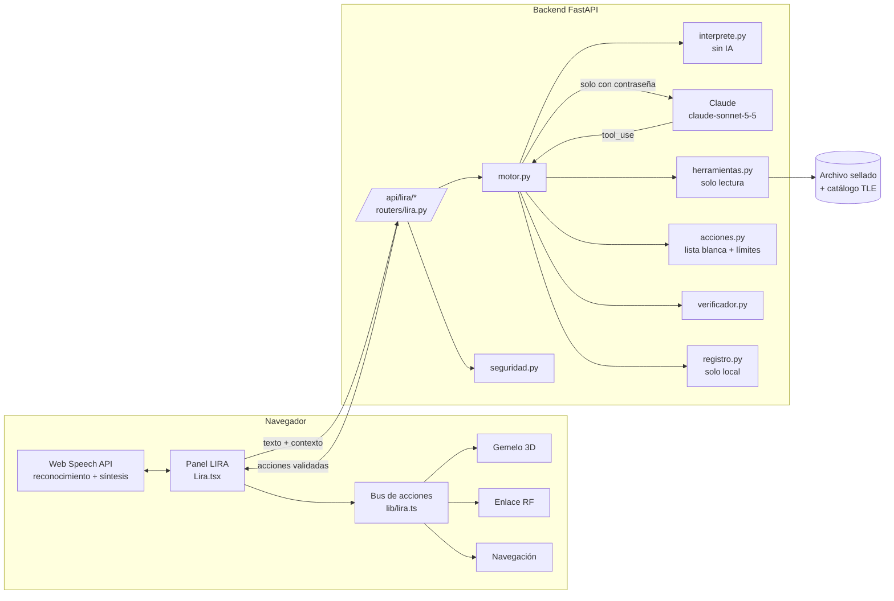
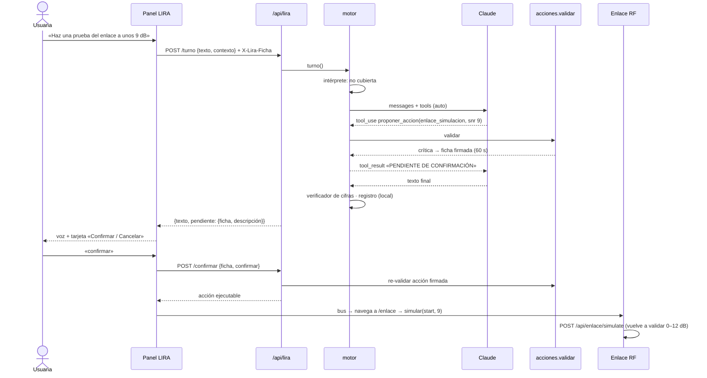

# LIRA AI — Language Intelligence for Real-time Aerospace Operations

Copiloto de misión de la plataforma STRaND-1, integrada en todas sus páginas (botón **LIRA**,
abajo a la derecha). Consulta la telemetría archivada, la explica y maneja la interfaz por voz o
por texto. Implementada el 2026-11-17.

> **Lo que LIRA no hace.** No envía nada al satélite —STRaND-1 está inactivo y la plataforma no
> tiene canal de comandos—, no ejecuta código y no inventa telemetría. Cada una de esas tres
> garantías tiene una prueba automática (§7).

## 1. Auditoría técnica (etapa 1)

| Pieza existente | Uso en LIRA |
| --- | --- |
| Archivo sellado (`validacion_cientifica/`) | fuente de toda la telemetría que consulta: sin base ni red |
| `gemelo_digital` (estado, anomalías) | lecturas por último valor conocido y diagnóstico estadístico |
| `health_monitor.catalogo` | qué es cada variable y **si STRaND-1 la emite** |
| `health_monitor.anomaly_detection.tendencia` | criterio documentado de tendencia |
| `orbita_sgp4` + catálogo de TLE sellado | posición, o por qué no la hay |
| Gemelo 3D (`GemeloDigital.tsx`) | vista, cámara, pestaña, reproducción, velocidad, fecha, magnitud |
| Enlace RF (`POST /api/enlace/simulate`) | iniciar / detener / reiniciar, SNR 0–12 dB |
| Navegación (`react-router`) | las 9 páginas y sus secciones |

Telemetría pedida en el encargo frente a la que existe:

| Pedida | Situación |
| --- | --- |
| Temperatura | **No disponible**: STRaND-1 nunca la emitió |
| Voltaje | Real; el canal vale la ordenada de la recta (cuenta ADC 0) desde 2021 |
| Corriente | 6 paneles reales; batería y bus nunca emitidas |
| Estado energético | Voltajes y corrientes; potencia y estado de carga **no disponibles** |
| Actitud, velocidad angular | **No se transmiten**; solo cuentas crudas de magnetómetro |
| Comunicaciones | Observaciones reales (SatNOGS) y enlace RF **simulado** |
| Variables orbitales | SGP4 donde hay TLE a ≤ 30 días (2023-06 en adelante); antes, no disponible |

## 2. Arquitectura (etapa 2)



Principios:

* **El modelo propone, el backend dispone.** Claude solo puede llamar a herramientas de consulta
  y a `proponer_accion`; cada propuesta pasa por `acciones.validar`. El frontend recibe acciones
  ya validadas y las ejecuta con los setters que ya existían en cada página.
* **Primero sin IA.** El intérprete determinista resuelve las órdenes de forma reconocible
  (gratis, inmediato, reproducible) y es lo único disponible sin contraseña.
* **Las cifras se comprueban.** El verificador busca cada número de la respuesta en lo que
  devolvieron las herramientas de ese turno.
* **Dependencias nuevas:** solo `anthropic==2.10.0` en el backend. El frontend no añade ninguna
  (la voz es la Web Speech API del navegador).

### Secuencia de un turno con acción crítica



### Contratos de la API

| Ruta | Entrada | Salida |
| --- | --- | --- |
| `GET /api/lira/estado` | — | `ia_configurada`, `requiere_clave`, `modelo`, `registro_activo`, `comandos_al_satelite: false` |
| `POST /api/lira/acceso` | `{clave}` | `{ficha, caduca_s}` · 401 contraseña · 429 tras 5 fallos en 10 min · 503 sin IA |
| `POST /api/lira/turno` | `{texto ≤2000, contexto, historial ≤12}` + cabecera `X-Lira-Ficha` | `{texto, modo, acciones[], pendiente, rechazadas[], consultas[], verificacion, uso}` |
| `POST /api/lira/confirmar` | `{ficha, decision: confirmar\|cancelar}` | `{ok, texto, acciones[]}` |
| `GET /api/lira/registro` | `n` | eventos recientes (solo local; 404 en Vercel) |

`modo`: `determinista` (sin IA), `ia` (Claude) o `sin_acceso` (lo entendido se hace; lo demás pide
la contraseña).

### Acciones permitidas (lista blanca cerrada)

| Acción | Parámetros | Crítica |
| --- | --- | --- |
| `navegar` | página (9) y sección | no |
| `gemelo_vista` | exterior · interior · explotada | no |
| `gemelo_camara` | isométrica (centrar) · frontal · lateral · superior | no |
| `gemelo_pestana` | monitor · subsistemas · estructura · procedencia | no |
| `gemelo_reproduccion` | reproducir · pausar | no |
| `gemelo_velocidad` | ×0,25 … ×300 (las del gemelo) | no |
| `gemelo_ir_a_fecha` | dentro del archivo (2016-11-30 a 2023-01-29) | no |
| `gemelo_magnitud` | magnitud numérica del archivo | no |
| `enlace_simulacion` | iniciar (SNR **0–12 dB**) · detener · reiniciar | iniciar y reiniciar |
| `restablecer_vista` | — | sí |

Un valor fuera de límites se **rechaza con el motivo**, nunca se recorta en silencio.

## 3. Seguridad y confiabilidad

| Requisito | Implementación |
| --- | --- |
| No inventar telemetría | herramientas con procedencia + reglas del prompt + **verificador de cifras** |
| Validación en backend | `acciones.validar` para todo, y el endpoint de enlace vuelve a validar |
| Límites | enumeraciones cerradas, SNR 0–12 dB, fechas dentro del archivo |
| Confirmación explícita | ficha HMAC-SHA256 de un solo uso, caduca a los 60 s |
| Cancelar | botón **Cancelar** (descarta respuestas en vuelo y la confirmación pendiente) y «cancelar» por voz |
| Registro | `lira/_registro/AAAA-MM-DD.jsonl`, **solo en local** (decisión de la usuaria); nunca contraseña, clave ni IP |
| Datos reales frente a simulados | cada valor lleva MEDIDO / CALCULADO / DERIVADO / SIMULADO / NO_DISPONIBLE |
| Sin código arbitrario | no hay herramienta que lo permita; «ejecuta este código» → rechazo |
| Sin comandos al satélite | no existe la acción; las órdenes al satélite se responden sin IA explicando por qué |
| Gasto de la IA | contraseña (`LIRA_CLAVE`), fichas de sesión de 12 h, 30 preguntas/hora por sesión, 300/día por instancia, 5 intentos de contraseña / 10 min por IP |

Los límites de uso viven en la memoria de cada instancia de Vercel: frenan el abuso pero no son
un tope exacto. **El tope real de gasto es el límite de la cuenta en la consola de Anthropic**,
que conviene configurar.

### Motor conversacional

`claude-sonnet-5-5` por la Messages API con herramientas propias y el bucle en nuestro backend
(máx. 6 llamadas y 45 s por turno; cada llamada se corta con el tiempo que queda, para no pasar de los 60 s de Vercel, ni en frío, cuando cargar el archivo cuesta unos 20 s), esfuerzo `medium`,
`tool_choice` automático (Sonnet 5.5 no admite forzar una herramienta) y **fallback del servidor
activado** (`fallbacks: "default"`): si el modelo rechaza una petición por sus filtros de
seguridad, la API la reintenta con un modelo alternativo dentro de la misma llamada.

## 4. Configuración

| Variable | Dónde | Para qué |
| --- | --- | --- |
| `ANTHROPIC_API_KEY` | Vercel (producción) y `backend/.env` | clave de la API de Anthropic |
| `LIRA_CLAVE` | Vercel (producción) y, opcionalmente, `backend/.env` | contraseña pública de la IA |
| `LIRA_SECRETO` | opcional | clave de firma; por defecto se deriva de la contraseña |

```bash
cd cubesat
vercel env add ANTHROPIC_API_KEY production
vercel env add LIRA_CLAVE production
```

La API de Anthropic es **de prepago** y aparte de cualquier suscripción de claude.ai: sin créditos en
la organización de la clave, cada pregunta a la IA responde «La cuenta de la IA no tiene saldo»
(503) y las órdenes directas siguen funcionando.

Sin `LIRA_CLAVE`, en Vercel la IA queda **desactivada** (nunca abierta por omisión). En local, sin
`LIRA_CLAVE`, la IA se permite sin contraseña. Cambiar `LIRA_CLAVE` invalida todas las sesiones.

## 5. Voz

Web Speech API, en español (`es-ES`). La síntesis funciona en todos los navegadores modernos.
El **reconocimiento** solo existe en Chrome y Edge, que **envían el audio a los servidores de
Google o Microsoft**; en Firefox el botón de micrófono queda desactivado y se usa el texto. El
panel muestra los estados: en espera, escuchando, procesando, respondiendo, ejecutando orden.

## 6. Pruebas (etapa 4)

**Automáticas, sin red ni gasto** (`tests/test_lira.py`, 102 pruebas, todas aprobadas el 2026-11-17;
suite completa del repositorio 380 aprobadas, 1 omitida):

| Grupo | Qué demuestra |
| --- | --- |
| Intérprete (≈45 frases) | órdenes, consultas, aclaración ante ambigüedad, órdenes al satélite rechazadas, preguntas complejas que no reciben plantilla |
| Acciones | lista blanca cerrada, límites de SNR, rechazos sin corrección, críticas sin ejecución previa, ficha alterada / caducada / reutilizada |
| Herramientas | temperatura y actitud NO_DISPONIBLE (nunca cero), procedencia, aviso de canal sin medida, órbita sin TLE no inventada |
| Verificador | cifras respaldadas, inventadas, redondeos, porcentajes, signo |
| Seguridad | IA cerrada por omisión en público, contraseña, bloqueo, límite de turnos |
| Motor con cliente simulado | modelo y parámetros enviados, resultado de herramienta devuelto, cifra inventada marcada, acción fuera de límite rechazada y válida pendiente, acción inventada rechazada, rechazo de seguridad, límite de pasos, sin sesión no se llama a la IA |
| API | validación de entradas, acceso, confirmación, registro solo local |

**De extremo a extremo en Chrome** (protocolo DevTools, backend y Vite locales): «vista explotada y
cámara superior» activa ambos botones del gemelo; «ve al 15 de marzo de 2020» mueve el cursor y la
consulta siguiente usa ese instante; la temperatura se responde como no disponible; un SNR de 15 dB
se rechaza; «inicia la simulación del enlace con 8 dB» muestra la tarjeta de confirmación y, al
confirmar, abre Enlace RF y ejecuta la cadena GNU Radio con SNR 8 dB (BER 5,3·10⁻⁵ registrado).
Esa prueba encontró y permitió corregir dos fallos: una orden nueva descartaba la anterior en vuelo,
y las acciones del enlace no abrían su página.

**Con Claude real (`lira/evaluar.py`, 24 casos, 2026-11-17): 23 de 24 aprobados** en la tercera
pasada; coste estimado de las tres pasadas, en torno a 1 USD. Los casos no los resuelve el intérprete
(una prueba lo vigila), así que todos miden a Claude. Turno más lento: 14,7 s.

| Pasada | Aprobados | Qué se cambió después |
| --- | --- | --- |
| 1 | 18/24 | Ninguna cifra inventada. Fallos: cifras correctas en otra forma (magnitud de una diferencia, «88,5° oeste», «16 horas»), que el verificador no reconocía; y `anomalias` solo devolvía los 10 eventos más largos, no el primero. Se añadieron esas formas a los resultados de las herramientas (no se relajó el verificador), el primer y el último evento, y una regla general: resolver referencias con herramientas antes de preguntar. |
| 2 | 21/24 | El verificador del modo IA no incluía los parámetros de las acciones validadas («velocidad 0,25»); un criterio de la prueba exigía la palabra «latitud» cuando la respuesta decía «27,30° norte». Ambos corregidos (el segundo es un error de la prueba, no del modelo). |
| 3 | 23/24 | — |

Fallo que se mantiene: «¿Qué paneles solares generaban más corriente justo antes del fallo?». Claude
consulta las anomalías, explica que ninguna está confirmada como falla y pregunta qué instante usar,
en lugar de elegir uno y consultar las corrientes. Es coherente con la regla de no declarar fallas,
pero no cumple el criterio; no se ha ajustado la prueba para que pase.

La construcción de la evaluación destapó además siete errores del intérprete determinista (p. ej.
«para» tomado por «parar», «reproducibilidad» por «reproducir», «apaga las ruedas» tratado como
consulta), todos corregidos y cubiertos por pruebas.

## 7. Limitaciones y mejoras posibles

* La evaluación con Claude real tiene 24 casos: es una muestra, no una garantía. Conviene ampliarla
  con frases reales del registro local.
* El intérprete determinista es un conjunto de reglas: lo que no reconoce pasa a la IA (o, sin
  contraseña, se dice qué sí se puede pedir). Puede crecer con las frases reales del registro.
* El reconocimiento de voz depende del navegador y de servicios externos.
* Sin streaming: la respuesta llega completa (un turno con varias herramientas tarda segundos).
* El registro de auditoría no existe en producción, por decisión expresa.
* LIRA no ve la selección de piezas ni el intervalo de la gráfica del gemelo; solo el instante,
  la magnitud, la vista, la cámara y si se reproduce.
